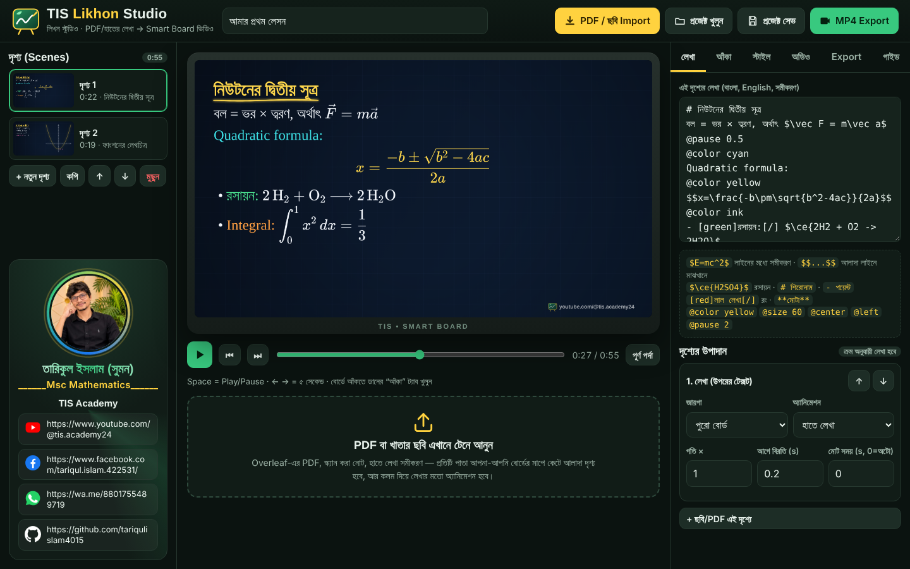
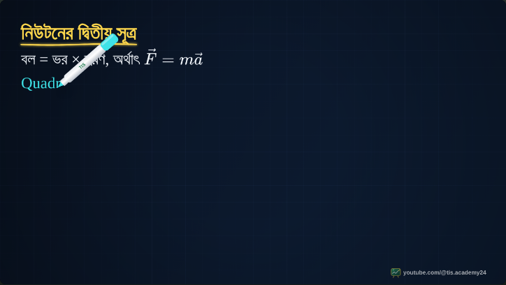
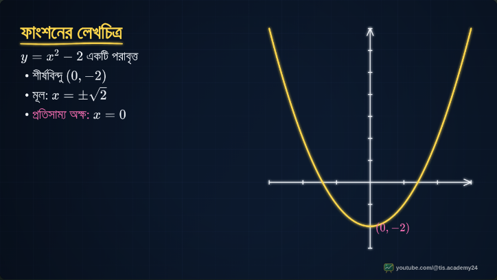

<div align="center">


# TIS Likhon Studio · লিখন স্টুডিও

**PDF বা হাতের লেখার ছবি দিন → Smart Board-এ কলম দিয়ে লেখার মতো অ্যানিমেশন → MP4 ভিডিও**

বাংলা · English · গণিত · পদার্থবিজ্ঞান · রসায়নের সমীকরণ — সম্পূর্ণ ফ্রি, ব্রাউজারেই চলে

[](LICENSE)


<a href="https://tariqulislam4015.github.io/tis-likhon-studio/"></a>



</div>

---

## ✨ কী কী করতে পারে

| | ফিচার |
|---|---|
| 📄 | **PDF Import** — Overleaf বা যেকোনো PDF; প্রতিটি পাতা আপনা-আপনি বোর্ডের মাপে কেটে আলাদা দৃশ্য হয় |
| ✍️ | **হাতের লেখার ছবি** — খাতার ছবি/স্ক্যান থেকে কালি আলাদা করে, কলম দিয়ে লেখার মতো ধাপে ধাপে আঁকে |
| 🧮 | **সমীকরণ** — `$E=mc^2$`, ভগ্নাংশ, মূল, ইন্টিগ্রাল (KaTeX); ভগ্নাংশে আগে লব → রেখা → হর |
| ⚗️ | **রসায়ন** — `$\ce{2H2 + O2 -> 2H2O}$` (mhchem) |
| 🎨 | **রঙিন চিত্র** — রেখা, তীর, বৃত্ত, ত্রিভুজ, অক্ষ, লেবেল, `y = f(x)` গ্রাফ, Freehand |
| 🖥️ | **৫ রকম বোর্ড** — Smart Board, সবুজ চকবোর্ড, কালো বোর্ড, হোয়াইটবোর্ড, গ্রাফ পেপার |
| 🖊️ | **কলম দেখা যায়** — মার্কার / চক / স্টাইলাস, সাথে কলম ঘষার শব্দ |
| 🎙️ | **সেরা শব্দ** — প্রতি দৃশ্যে আলাদা ভয়েস, ব্যাকগ্রাউন্ড মিউজিক (ভয়েসের সময় আপনা-আপনি কমে), ভয়েস এনহ্যান্স, 48 kHz স্টেরিও, 320 kbps পর্যন্ত |
| 🎬 | **MP4 Export** — 1080p/720p, 30/60 fps, H.264 — সরাসরি YouTube-এ আপলোডযোগ্য |
| 👤 | **ব্র্যান্ডিং** — শুরুতে লোগো + লেসনের নাম, শেষে নির্মাতার পরিচিতি ও লিংক, কোণায় ওয়াটারমার্ক |

<table><tr>
<td></td>
<td></td>
<td></td>
</tr></table>

---

## 🚀 চালানোর ৩টি উপায়

### ১. অনলাইনে (সবচেয়ে সহজ)
👉 https://tariqulislam4015.github.io/tis-likhon-studio/ — Chrome বা Edge-এ খুলুন। চাইলে ঠিকানা বারের **Install** আইকনে চাপ দিয়ে অ্যাপের মতো ইনস্টলও করা যায়।

### ২. নিজের কম্পিউটারে (Windows)
1. উপরের সবুজ **Code → Download ZIP** চাপুন, তারপর Extract করুন।
2. `start-windows.bat`-এ ডাবল-ক্লিক করুন (Python লাগবে — [python.org](https://www.python.org) থেকে ফ্রি)।
3. ব্রাউজারে `http://localhost:8080` খুলে যাবে।

### ৩. Mac / Linux
```bash
git clone https://github.com/tariqulislam4015/tis-likhon-studio.git
cd tis-likhon-studio
./start-mac-linux.sh
```

> ⚠️ `index.html` সরাসরি ডাবল-ক্লিক করে খুললে PDF Import কাজ করবে না (ব্রাউজারের নিরাপত্তা নিয়ম)। উপরের যেকোনো একটি উপায় ব্যবহার করুন।

---

## 📝 লেখার নিয়ম (লেখা ট্যাব)

```text
# নিউটনের দ্বিতীয় সূত্র
বল = ভর × ত্বরণ, অর্থাৎ $\vec F = m\vec a$
@color yellow
$$x=\frac{-b\pm\sqrt{b^2-4ac}}{2a}$$
- [green]রসায়ন:[/] $\ce{2H2 + O2 -> 2H2O}$
@pause 1.5
- **গুরুত্বপূর্ণ:** $\int_0^1 x^2\,dx=\frac13$
```

| লিখুন | ফলাফল |
|---|---|
| `$...$` | লাইনের ভেতরে সমীকরণ |
| `$$...$$` | আলাদা লাইনে, মাঝখানে সমীকরণ |
| `$\ce{H2SO4}$` | রাসায়নিক সংকেত/বিক্রিয়া |
| `# শিরোনাম` | বড় হলুদ শিরোনাম, নিচে দাগ |
| `- পয়েন্ট` | বুলেট |
| `[red]লেখা[/]` | রঙিন লেখা (red, blue, green, yellow, orange, pink, cyan, purple, white, অথবা `#ff8800`) |
| `**মোটা**` | বোল্ড |
| `@color yellow` | এরপরের সব লেখার রং |
| `@size 60` | লেখার সাইজ |
| `@center` / `@left` / `@right` | লেখার অবস্থান |
| `@pause 2` | ২ সেকেন্ড থেমে পরের লাইন |
| `@gap 40` | ফাঁকা জায়গা (px) |

---

## 🧰 সম্পূর্ণ ফ্রি সহায়ক টুল

| কাজ | টুল |
|---|---|
| সুন্দর সমীকরণসহ PDF | [Overleaf](https://www.overleaf.com) (Compiler: **XeLaTeX** বাংলার জন্য) |
| খাতার লেখা স্ক্যান | Microsoft Lens / Adobe Scan (মোবাইল অ্যাপ) |
| ভয়েস রেকর্ড ও নয়েজ কমানো | [Audacity](https://www.audacityteam.org) |
| বড় এডিটিং (After Effects-এর বিকল্প) | [DaVinci Resolve](https://www.blackmagicdesign.com/products/davinciresolve) |
| 3D অ্যানিমেশন | [Blender](https://www.blender.org) |
| কোড দিয়ে গণিত অ্যানিমেশন | [Manim](https://www.manim.community) |
| ভিডিও ছোট করা | [HandBrake](https://handbrake.fr) |

**Overleaf-এ বাংলা + সমীকরণ:**
```latex
\documentclass{article}
\usepackage{fontspec,polyglossia,amsmath}
\setmainlanguage{bengali}
\setotherlanguage{english}
\newfontfamily\bengalifont[Script=Bengali]{Noto Sans Bengali}
\begin{document}
নিউটনের সূত্র: $\vec F = m\vec a$
\end{document}
```

---

## 💡 সেরা ফলের টিপস
- সাদা কাগজে গাঢ় কালিতে লিখুন, সোজা উপর থেকে আলোয় ছবি তুলুন।
- কালো লেখা Smart Board-এ চকের মতো সাদা হয়; রঙিন কালি রং সহই আসে। উপাদানের **“কালি”** অপশনে বদলানো যায়।
- ঘন পাতা হলে উপাদানে **“মোট সময়”** দিন (যেমন `40`) — পুরো পাতা ঠিক ৪০ সেকেন্ডে লেখা হবে।
- ভয়েস ফোনে/Audacity-তে WAV বা M4A-তে রেকর্ড করে **অডিও ট্যাবে** দিন — দৃশ্যটি ভয়েসের সমান লম্বা হবে।
- কাজ **“প্রজেক্ট সেভ”** করে রাখুন (`.likhon.json`), পরে খুলে আবার এডিট করা যাবে।
- ক্লাসে সরাসরি দেখাতে **“পূর্ণ পর্দা”** চাপুন।

---

## ⚙️ কীভাবে কাজ করে (English, for developers)

TIS Likhon Studio is a **zero-build, single-page web app** — plain HTML/CSS/JS, no framework, no server.

- **Ink extraction** — estimates the paper background per 16 px block (max/min filter + blur) and turns darkness/saturation into ink alpha; keeps coloured ink, maps grey ink to chalk on dark boards.
- **Stroke-order animation** — connected ink components are put in reading order (line grouping, diacritics attached to their line, fraction-aware: numerator → bar → denominator). Inside each component, pixels are revealed in BFS order from the stroke start, so the ink "grows" along the stroke like a real pen.
- **Text & math** — Bangla/English text and KaTeX are laid out in a hidden DOM, then painted glyph-by-glyph onto a canvas (no tainting), then animated by the same engine.
- **Audio** — narration, ducked music, synthesized pen/chalk scratch, transitions and chimes are mixed in an `OfflineAudioContext` and peak-normalized to −1 dBFS.
- **Export** — frames rendered deterministically to an `OffscreenCanvas`, encoded with **WebCodecs** (H.264 + AAC, or Opus where AAC isn't available) and written by a small built-in **MP4 muxer** (faststart). Falls back to `MediaRecorder` on browsers without WebCodecs.

```
tis-likhon-studio/
├── index.html              ← the whole app (UI + engine + MP4 muxer)
├── manifest.webmanifest    ← makes it installable as an app
├── assets/                 ← logo, app icons, creator photo
├── lib/                    ← KaTeX, mhchem, PDF.js (vendored) + licenses
├── docs/                   ← screenshots + GITHUB-UPLOAD-GUIDE.md
├── start-windows.bat       ← local launcher (Windows)
└── start-mac-linux.sh      ← local launcher (macOS/Linux)
```

**Browser support:** Chrome / Edge 94+ recommended (WebCodecs). Firefox and Safari work for editing; export may fall back to real-time recording.

---

## 👤 নির্মাতা


### তারিকুল ইসলাম (সুমন)
**______Msc Mathematics______**
**TIS Academy** — *Teach Idea For Success*

<br clear="left">

[](https://www.youtube.com/@tis.academy24)
[](https://www.facebook.com/tariqul.islam.422531/)
[](https://wa.me/8801755489719)
[](https://github.com/tariqulislam4015)

---

## 📜 লাইসেন্স
সোর্স কোড [MIT License](LICENSE)-এ। ব্যবহৃত লাইব্রেরির লাইসেন্স [THIRD_PARTY_NOTICES.md](THIRD_PARTY_NOTICES.md)-এ। নির্মাতার ছবি, “TIS Academy” নাম ও লোগো নির্মাতার নিজস্ব — Fork করলে নিজেরগুলো বসিয়ে নিন।

⭐ ভালো লাগলে রিপোজিটরিতে একটি Star দিন এবং YouTube চ্যানেলটি Subscribe করুন!
